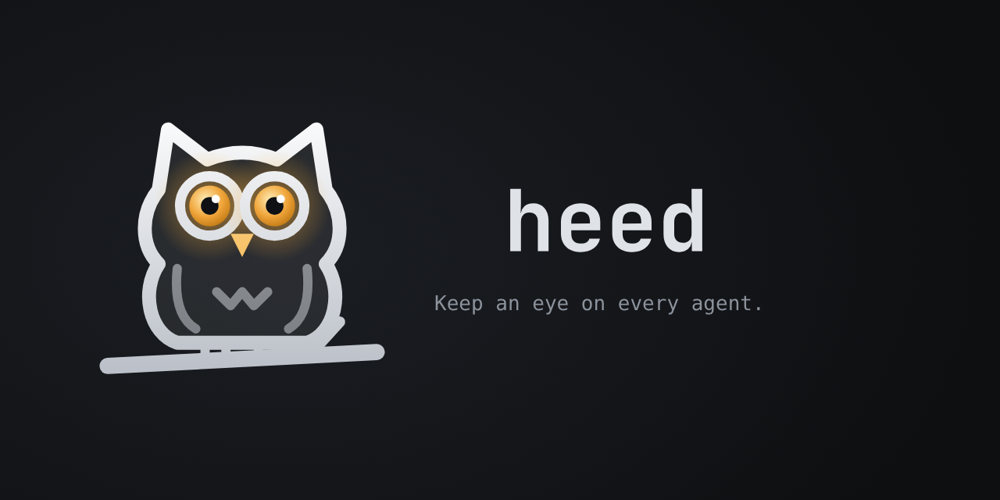

<p align="center">
  
</p>

**heed** is a native macOS app that feels and works like a TUI, with vim-inspired modes and key bindings. It runs
Claude, Codex, Cursor, pi, opencode and gemini in real terminals, a worktree per task, watches what each one is up to,
and taps your shoulder only when one needs you.

```sh
curl -fsSL https://heed.nullean.net/install.sh | sh
```

[Documentation](https://heed.nullean.net) · [Source](https://github.com/heed-build/heed) ·
[Releases](https://github.com/heed-build/heed/releases)
